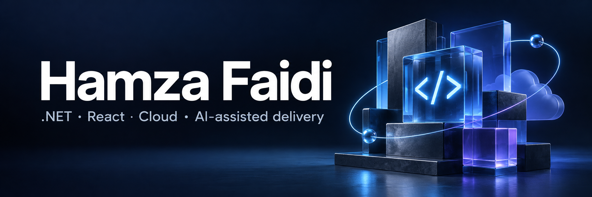

  

  <a href="https://www.hfsoftwareservices.com/"><strong>Portfolio & contact ↗</strong></a>
  &nbsp; · &nbsp;
  <a href="#selected-work">Selected work</a>
  &nbsp; · &nbsp;
  <a href="#open-source">Open source</a>

I'm **Hamza**, a .NET and React engineer working on SaaS, payments and cloud systems. I bring backend depth, full-stack delivery and AI-assisted workflows with planning, review and verification.

**Tunis, Tunisia** · Founder of **HF Software Services** · C/C++ and OOP instructor

## Selected work

<table>
<tr>
<td width="50%" valign="top">
<h3>01 · System Design Coach</h3>

Chapter-based quizzes, explanations and saved progress for system-design practice.

React · TypeScript · Vite

<a href="https://www.sysdesigncoach.org/"><strong>Live app ↗</strong></a> &nbsp; <a href="https://github.com/hamzafa1d1/SystemDesignForInterviewsTrainingQuizApp">Source code</a>

</td>
<td width="50%" valign="top">
<h3>02 · Payment MCP Lab</h3>

Tools, resources and prompts over synthetic payment data. An independent learning lab with in-memory state.

TypeScript · MCP · Zod

<a href="https://github.com/hamzafa1d1/mcpServer"><strong>Explore the lab ↗</strong></a> &nbsp; <a href="https://github.com/hamzafa1d1/mcpServer/actions/workflows/check.yml">Build & smoke check</a>

</td>
</tr>
<tr>
<td width="50%" valign="top">
<h3>03 · ASDLC Capstone Guide</h3>

Practical teaching material for agent-assisted delivery, verification and project milestones.

Engineering education · AI workflows

<a href="https://hamzafa1d1.github.io/asdlc-capstone-guide/"><strong>Read the guide ↗</strong></a> &nbsp; <a href="https://github.com/hamzafa1d1/asdlc-capstone-guide">Source code</a>

</td>
<td width="50%" valign="top">
<h3>04 · Typerr</h3>

Desktop typing metrics and correction tracking, with optional Gemini audit analysis.

Electron · React · TypeScript

<a href="https://github.com/hamzafa1d1/typerr-desktop-app"><strong>Explore the project ↗</strong></a> &nbsp; <a href="https://github.com/hamzafa1d1/typerr-desktop-app/releases">Release assets</a>

</td>
</tr>
</table>

## What I work with

**Backend** &nbsp; C# / .NET · TypeScript / Node.js  
**Interfaces** &nbsp; React · Angular  
**Data & cloud** &nbsp; SQL Server · PostgreSQL · AWS · Azure · Terraform  
**Delivery** &nbsp; GitHub Actions · Playwright · MCP · agent workflows

Most commercial work lives in private repositories. My public projects show independent work, teaching and learning; they are labeled accordingly.

## Open source

Two contributions merged into **[Twenty](https://github.com/twentyhq/twenty)**:

- **More resilient filters** — [handle malformed stored values without crashing dropdowns](https://github.com/twentyhq/twenty/pull/18513).
- **More reliable tests** — [repair the downloadFile promise chain and stabilize its unit test](https://github.com/twentyhq/twenty/pull/18484).

<strong>More learning and teaching</strong>

I teach C/C++ and object-oriented programming and share practical engineering guides. My [AWS Terraform lab](https://github.com/hamzafa1d1/TerraformAWSAutomationProject) explores reusable infrastructure modules and separate environment roots.

---

**Have a project in mind?** [See my engineering background and get in touch ↗](https://www.hfsoftwareservices.com/)
