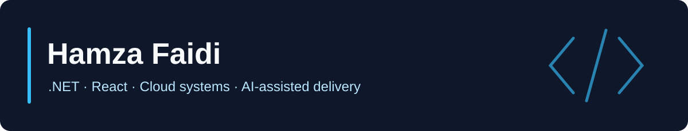

# Hamza Faidi

**.NET and React engineer building SaaS, payments and cloud systems.**

I work across backend APIs, web interfaces and cloud delivery, with a focus on reliable behavior and clear verification. I also use AI-assisted engineering workflows with planning, review and testing built into the delivery process.

Based in Tunis, Tunisia. Founder of **HF Software Services**.

[Portfolio and contact](https://www.hfsoftwareservices.com/) · [System Design Coach](https://www.sysdesigncoach.org/)

## Selected projects

| Project | What it demonstrates | Explore |
|---|---|---|
| **System Design Coach** | A React and TypeScript quiz companion with chapter practice, explanations and saved progress. | [Demo](https://www.sysdesigncoach.org/) · [Code](https://github.com/hamzafa1d1/SystemDesignForInterviewsTrainingQuizApp) |
| **Payment MCP Lab** | A TypeScript learning project exploring MCP tools, resources and prompts with synthetic payment data. State is held in memory. | [Code and setup](https://github.com/hamzafa1d1/mcpServer) |
| **ASDLC Capstone Guide** | Practical teaching material for agent-assisted software delivery, verification and project milestones. | [Guide](https://hamzafa1d1.github.io/asdlc-capstone-guide/) · [Code](https://github.com/hamzafa1d1/asdlc-capstone-guide) |
| **HF Software Services** | My professional portfolio and engineering background. | [Website](https://www.hfsoftwareservices.com/) · [Code](https://github.com/hamzafa1d1/hfsoftwareservices) |

## Open source contributions

Two contributions merged into [Twenty](https://github.com/twentyhq/twenty):

- [Handle malformed stored filter values without crashing dropdowns](https://github.com/twentyhq/twenty/pull/18513).
- [Repair the downloadFile promise chain and stabilize its unit test](https://github.com/twentyhq/twenty/pull/18484).

## Engineering background

My professional work includes .NET payment and card workflows, SaaS APIs and interfaces, SQL diagnosis, cloud delivery and AI-assisted development practices. Most commercial work lives in private repositories; the projects here show selected independent work, learning and public contributions.

**Backend:** C# / .NET, TypeScript / Node.js  
**Frontend:** React, Angular  
**Data and cloud:** SQL Server, PostgreSQL, AWS, Azure, Terraform  
**Delivery:** GitHub Actions, Playwright, agent workflows and MCP

## Learning and teaching

I teach C/C++ and object-oriented programming and share practical engineering guides. My [AWS Terraform lab](https://github.com/hamzafa1d1/TerraformAWSAutomationProject) explores reusable infrastructure modules and separate environment roots.

## Get in touch

For engineering work or a project conversation, visit [HF Software Services](https://www.hfsoftwareservices.com/).
